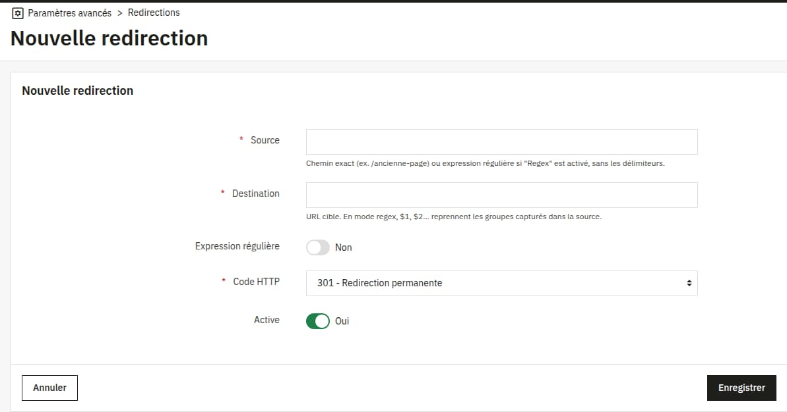

# Module Redirections

Ce module PrestaShop permet de gérer des redirections HTTP depuis le back-office : création, modification, suppression,
désactivation temporaire, gestion de l'ordre, expressions régulières avec remplacement et import CSV.

 

## Fonctionnalités

- Liste des redirections avec filtres, tri et actions groupées (suppression)
- Redirection exacte (comparaison du chemin, slash final ignoré) ou par expression régulière
- Remplacement avec groupes capturés : `$1`, `$2`… dans l'URL de destination
- Codes HTTP 301, 302, 307 et 308
- Activation / désactivation d'une redirection en un clic, sans la supprimer
- Ordre géré par glisser-déposer : la première règle qui correspond s'applique
- Import CSV au format `source;destination;code`
- Validation de l'expression régulière à l'enregistrement
- Les redirections s'appliquent avant la résolution du contrôleur, y compris sur une URL qui renverrait un 404

## Installation

1. Téléchargez le module
2. Décompressez-le dans le dossier `/modules` de votre installation PrestaShop (le dossier doit s'appeler `redirect`)
3. Installez le module depuis le back-office de PrestaShop
4. La page est accessible via **Paramètres avancés > Redirections**

## Configuration requise

- PrestaShop 9.0 ou plus récent
- PHP 8.1 ou plus récent

## Utilisation

1. Ouvrez **Paramètres avancés > Redirections** puis cliquez sur **Ajouter une redirection**
2. Renseignez la source, la destination et le code HTTP
3. Réordonnez les règles avec la poignée de la colonne Position
4. Utilisez l'interrupteur de la colonne Active pour désactiver temporairement une redirection

### Expressions régulières

Activez l'option **Expression régulière** et saisissez le motif **sans délimiteurs** (le module ajoute `#` et le
modificateur `u`). La source est comparée au chemin de l'URL, sans la query string.

| Source             | Destination                 | Résultat                                |
|--------------------|-----------------------------|-----------------------------------------|
| `^/blog/([0-9]+)$` | `/articles/$1`              | `/blog/42` redirige vers `/articles/42` |
| `^/old/(.*)$`      | `https://exemple.fr/new/$1` | redirection vers un autre domaine       |

### Import CSV

Une ligne par redirection, séparateur point-virgule, encodage UTF-8 :

```csv
source;destination;code
/ancienne-page;/nouvelle-page;301
/promo;https://exemple.fr/offre;302
```

- La ligne d'en-tête est facultative
- Le code est facultatif (301 par défaut) ; les valeurs acceptées sont 301, 302, 307 et 308
- Les redirections importées sont des correspondances exactes (non regex), activées et ajoutées en fin de liste
- Les lignes invalides sont ignorées et listées dans un message d'erreur

## Screenshot



## License

> This program is free software; you can redistribute it and/or modify it under the terms of the GNU General Public
> License, version 3, as published by the Free Software Foundation.
>
> This program is distributed in the hope that it will be useful, but WITHOUT ANY WARRANTY; without even the implied
> warranty of MERCHANTABILITY or FITNESS FOR A PARTICULAR PURPOSE. See the GNU General Public License for more details.

A copy of the license is included in the root of the module's directory. The file is named `LICENSE`.

## Crédits

### Answeb - Développement du module

Ce module a été développé par [Answeb](https://www.answeb.net), agence spécialisée dans le développement web et les
solutions e-commerce. Answeb accompagne les entreprises dans leur transformation digitale en créant des solutions
sur-mesure adaptées à leurs besoins spécifiques.

**Expertise Answeb :**

- Développement WordPress & WooCommerce, Prestashop
- Intégrations ERP et solutions métier
- Connecteurs et API personnalisés
- Solutions e-commerce avancées

Pour toute question technique ou demande d'évolution du module, vous pouvez contacter l'équipe Answeb via notre
site web.

## Contribution

Les contributions sont les bienvenues ! Si vous souhaitez contribuer à ce projet, faites une pull request sur la branche
develop. Vous devriez également ouvrir une issue pour documenter votre contribution.
